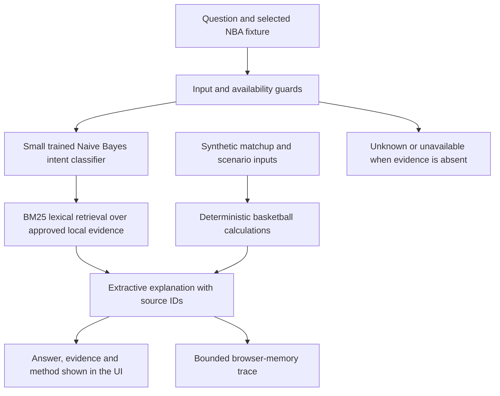
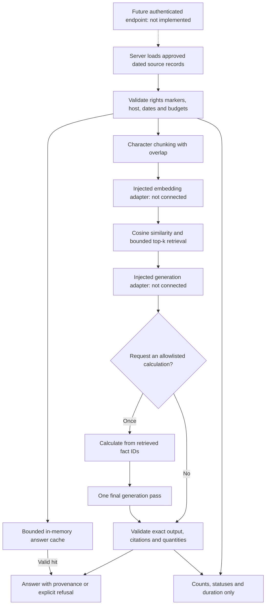

# AI Insight Lab architecture: what runs and what comes next

## Server integration update — 16 November 2026

The current version adds a server-backed real-game desk. The BALLDONTLIE HTTP adapter, game-evidence retrieval, model HTTP adapters and private API routes are implemented and mock-tested; no provider account/key or real model call is yet verified. The local learning assistant described below remains a separate synthetic-data path. The embedding/generation route defaults disabled. See [model setup](model-setup.md), [forecasting](forecasting.md), server/application.mjs, server/nba-provider.mjs, server/live-evidence.mjs and server/model-adapters.mjs for the new boundaries. A key being present does not establish genuine RAG or forecast accuracy.


Updated 16 November 2026. Current scope: NBA basketball.

AI Insight Lab has two deliberately separate paths. The private prototype runs a small local text classifier, lexical retrieval, extractive explanations and deterministic basketball calculations in the browser. The server integration includes real HTTP adapter code and a private model route, disabled until separately configured and authorized. No provider SDK or key is bundled. Embedding and generation are verified with scripted fakes only; no real-model response has been established.

No live scores, schedules, current player injuries, bookmaker odds or licensed sports feed are connected. NBA team profiles, matchup baselines and scenario changes are explicitly synthetic. Official NBA definition references do not supply current team statistics or imply a data licence. The displayed scenario percentage is untrained and unvalidated.

## The explanation Avi can give in an interview

“The current app uses a small trained classifier to identify the kind of question, then retrieves relevant approved evidence with lexical scoring. It assembles a cited explanation and lets code do the arithmetic. That keeps the demonstration inexpensive and makes important behavior testable. It is not a language-model RAG deployment. I also implemented a separate server pipeline with replaceable embedding and language-model functions, bounded vector retrieval, a calculation tool and strict citation and numerical checks. The pipeline tests use fakes; the next milestone is an authorized provider integration evaluated against held-out NBA questions.”

The useful distinction is between learning to route a question, retrieving evidence, generating language and predicting an outcome. They solve different problems. A classifier's confidence is not a team's win probability. A citation is not proof of a forecast, and a scenario slider is not a trained prediction model.

## Current browser path



`dist/evidence.js` holds the curated corpus, source register and dated synthetic fixtures. `dist/engine.js` owns routing, retrieval, explanations, calculators and local observability. `dist/app.js` presents those results. The engine makes no external model or sports-data API calls. See [AI concepts and status](ai-concepts.md) for the concept-by-concept implementation and evaluation map.

The browser evidence is already authored as short, meaningful records. It does not need a vector database. Lexical retrieval is called lexical retrieval throughout the project; it is not represented as embedding search or generative RAG.

## Optional server pipeline

`server/rag.mjs` is a provider-independent JavaScript module suitable for a future server or Worker integration. It is not an HTTP endpoint. The default behavior makes the missing integration observable:

```js
import { createRagPipeline } from './server/rag.mjs';

const rag = createRagPipeline();
const result = await rag.run({ question: 'Explain this NBA matchup', documents: [] });
// result.status === 'unavailable'
// result.code === 'not_connected'
// result.metrics.embeddingCalls === 0
// result.metrics.generationCalls === 0
```



Solid arrows describe implemented orchestration when adapters are supplied. Dashed entry and unconnected adapters represent future integration. The tests run that orchestration with **scripted fake adapters**, not a real embedding model or language model.

### Adapter contract

```js
const rag = createRagPipeline({
  // Trusted server functions supplied only after an approved integration:
  embed,       // async ({ texts, signal }) => number[][]
  generate,    // async ({ system, question, evidence, toolResults, tools,
               //          schema, maxOutputTokens, signal }) => JSON object/string
  allowedSourceHosts: ['approved-data-host.example'],
  modelId: 'deployment-version',
  embeddingId: 'encoder-version',
  trace: event => { /* optionally store only this minimal event */ },
});
```

There is no suggested key value and no adapter that makes an API call. `modelId` and `embeddingId` are safe version labels, not credentials. A future adapter must preserve instruction hierarchy, implement provider-side output limits, accept cancellation, and translate `OUTPUT_SCHEMA` to its provider's supported structured-output dialect. Passing a schema to this callback does not establish that any real provider supports or obeys it. Independent runtime validation always runs afterward.

### Source records and trust boundaries

An input document has `source`, `text` and optional structured `facts`. The source requires:

- A unique source ID, title and URL on a server-configured HTTPS host allowlist. URLs cannot contain credentials, ports, query strings or fragments.
- Explicit UTC `asOf` and `retrievedAt` dates, with chronological consistency, no future dates and a maximum age.
- `dataKind: 'synthetic'` or `'connected'`; retrieval preserves this distinction in the final answer.
- Explicit administrator approval markers for both display and AI use, plus a reviewer ID. These markers document an ingestion decision; **they do not verify licensing or source authenticity**.
- Optional coverage labels. Injury questions need a connected source explicitly covering injuries, with both dates within the configured freshness window.

A future endpoint must load these documents from a server-controlled ingestion store. **Clients must not submit source records, attest their own rights or mark their own content connected.** The module is an internal orchestration API, not a safe public request contract. A host allowlist limits URLs; it does not fetch, authenticate or validate their contents. No source URL is fetched by the module.

Structured facts are ingestion records with an ID, label, finite value and unit. They are not automatically extracted or verified against a vendor. For chunking, offsets refer to the normalized, trimmed document text. Each chunk carries the document's structured facts. A numerical citation therefore establishes **document-level fact provenance**, not proof that the exact cited text span contains the fact. Labels, units and source mappings need review at ingestion.

The injury keyword guard is a useful extra check, not a complete intent detector. It cannot establish that a provider's coverage is reliable or that a player's status is current. The static app reports injury data unavailable because no feed is connected. The default thirty-minute server window is an example policy to test, not a vendor refresh promise.

### Retrieval, calculation and generation

`chunkDocuments` splits bounded text into character chunks with overlap. `cosineSimilarity` validates finite, nonzero, matching-dimensional vectors. `retrieveByVector` ranks them, applies a minimum similarity and returns a bounded number of chunks. There is no embedded semantic encoder, learned embedding model, persistent vector database or semantic-quality result. Cosine scores are similarities, not calibrated confidence values.

An embedding adapter receives one bounded batch containing the question and chunks. A generation adapter receives a fixed system instruction and separate question, evidence and tool-result fields. This preserves role boundaries in the interface; the adapter must maintain them at the provider boundary.

The model may request the `calculate` function once. Only `difference`, `mean` and `ratePercent` are allowed, using IDs of facts in the retrieved evidence. There is no `eval`, arbitrary expression, network tool, filesystem tool or supplied raw-operand calculation. Operands must share a unit, division by zero is rejected, and tool results retain operand fact IDs and citations. Arithmetic uses JavaScript finite numbers; display rounding must be deterministic. These generic operations do not create a trained NBA predictor.

The final model response must be exactly one of an answer, a refusal or a first-pass tool request. An answer contains claims, citations and typed quantities. Every claim must cite retrieved chunk IDs. Each numerical record must exactly match a supplied fact or calculated result, including its unit, and cite its originating evidence. Model prose cannot contain decimal digits, including Unicode digits or quantities attached to units, or common spelled-out number and quantity words. Known certainty or guaranteed-outcome phrases are rejected. Availability claims must cite fresh connected injury coverage even when the original question did not ask about injuries. Quantities are rendered separately from validated typed records.

These checks prevent an unknown citation or changed typed value from being silently accepted. They do **not** establish semantic entailment of prose, validate a fact's meaning, detect every way of spelling a quantity or expressing certainty, authenticate external sources or prove that a model interpreted a number correctly. An answer can have a real citation and still misdescribe its source. Real-model release needs semantic evaluation and review in addition to these checks.

### Safety, observability and cost controls

Implemented controls include known-pattern injection checks on questions, evidence, source titles and facts; role separation; a narrow tool allowlist; strict output validation; refusal without sufficiently similar evidence; and explicit synthetic/unvalidated labels. Pattern matching can miss attacks or reject innocent text. No single prompt or regular expression provides complete injection protection. The generator is given no secret, browser, URL-fetching or arbitrary execution tool.

Default server budgets are intentionally small:

| Control | Default |
| --- | --- |
| Question | 600 characters |
| Evidence | 12 documents; 36,000 text characters total |
| Chunking | 1,000 characters; 100-character overlap; 48 chunks maximum |
| Retrieval | At most 4 chunks; cosine threshold 0.25 |
| Generation | At most 2 calls; 1,200 requested output tokens each; 8,000 returned JSON characters |
| Tools | At most 3 calculations in a single round |
| Deadline | 10 seconds per request |
| Concurrency | At most 2 active requests or unresolved adapter calls per pipeline instance |
| Cache | 16 answer entries; 60-second time to live |
| Injury evidence | Both source dates within 30 minutes |

The module applies absolute configuration bounds as well. A SHA-256 cache key includes the question, selected evidence, adapter versions and limits. Only the key and answer are retained; raw question text is not a cache key. Source freshness is rechecked before cache use, including the shorter injury window for any cached availability claim. Cache entries are deep copied, bounded, expire and can be cleared. This is a per-instance memory cache; it is not a durable multi-user cache. It is disabled when Web Crypto is unavailable. The pipeline currently recomputes embeddings on an uncached request; a licensed versioned embedding cache is a future optimization.

Trace events contain request sequence ID, stage/status, safe adapter version labels, counts, cache hit and duration. They do not contain questions, evidence text, source URLs, keys or provider exception messages. Provider errors are redacted even if an adapter throws the module's custom error type. The module does not install a persistent telemetry service. A host must keep any future logging sink equally narrow and set retention limits.

The deadline returns a refusal and sends an abort signal. An adapter that ignores cancellation can continue running remotely and may still bill. Its local slot stays occupied until it settles, preventing repeated timeouts from accumulating unlimited calls in one pipeline instance. This local guard does not limit other instances or establish a dollar spending cap.

Current external API/model spend is zero because no external call is implemented. Character limits are not provider token accounting. Output-token requests must be enforced by a future adapter, and a provider may bill work that times out. No global rate limiter, usage ledger, provider quota or guaranteed dollar cap is implemented.

Before any paid integration, add a server-side **fail-closed spending ledger**: atomically reserve the worst-case authorized cost before each call, including embeddings and maximum output; reject requests when spent plus reserved cost would exceed the cap; reconcile actual usage; retain reservations for ambiguous timeouts; disable automatic paid retries; and refuse work when accounting is unavailable. Combine this with authenticated rate limits and an actually enforced provider quota where available. A dashboard alert alone is not a hard cap. Keep provider keys in server runtime secrets, never `dist/`, source control, traces or browser storage. Paid services and secrets still require authorization.

## Evaluation and remaining evidence gaps

`node --test tests/rag.test.mjs` currently passes **25 tests** on Node 24.22.1. These are local contract and regression tests. They cover dates, rights markers, chunk offsets, pure vector math, missing evidence, calculation restrictions, fake function-calling, exact citations/units/quantities, Unicode digits, malicious instructions, absent injury coverage, cache invalidation, mutation isolation, deadlines, cancellation, concurrency, malformed inputs, output budgets, string-only identity fields, availability synonyms, unsupported certainty claims, spelled-out quantities and error/trace redaction.

The embedding adapter in the tests maps a few strings to hand-assigned numeric vectors. The generator returns prewritten objects. This is useful for exercising the plumbing repeatably, but it does **not** establish useful semantic retrieval, model reasoning, real-provider structured output compliance or end-to-end RAG quality. No such result is reported. The browser engine has its own held-out routing/evidence dataset and evaluation command; see [AI concepts](ai-concepts.md).

For an authorized model integration, keep a versioned held-out NBA question set separate from prompts and tuning examples. Label acceptable source records, answerable versus unavailable cases, numerical facts, stale and missing injuries, prompt-injection attempts and required limitations. Measure retrieval recall at k, unsupported-answer/refusal rates, citation correctness and entailment, numerical mismatch rate, schema failures, latency and actual billed cost. Record dataset, corpus, prompt, embedding and model versions. Compare against the current extractive baseline. Human review of prose remains necessary; an LLM judging another LLM is not sufficient ground truth.

No online model evaluation or real-user experiment has run. Minimal local traces support debugging; they are not evidence of production quality. Any future online feedback should be voluntary, minimal and privacy-aware, with raw question collection disabled by default.

## Predictive modeling is a separate milestone

The scenario function subtracts hand-authored hypothetical penalties from a hand-authored baseline. Neither the baseline nor its adjustments were fitted to historical NBA outcomes. There is no demonstrated predictive accuracy, calibration, backtest, profit or betting edge.

Before reporting a model forecast, obtain licensed historical outcomes and time-stamped pregame features; preserve injury unknowns explicitly; prevent post-tipoff or future-data leakage; split train, validation and test periods chronologically; and compare a simple baseline to the candidate model. Fit any probability calibration on validation data only. Report untouched-test Brier score, log loss, reliability diagrams with sample counts and uncertainty, and results by relevant season/slice. A calibration curve with too few games cannot support strong conclusions. Keep historical evaluation separate from any synthetic UI fixtures. These activities are planned, not simulated results.

Agents and MCP are not runtime dependencies. A single bounded pipeline is enough for this MVP. An agent would add tool-selection and failure modes without a current product need. A future read-only MCP connector could expose licensed evidence to other clients, but it would still require the same authentication, provenance, rights and budget controls. Neither is implemented or needed to explain the current architecture.

## Safe evolution order

1. Keep the private NBA demo honest and evaluate its local routing, retrieval and calculations.
2. Resolve rights, refresh policy and reliable NBA injury coverage using the research register. Connect only authorized server-side sources; retain source times and unknown availability.
3. Add an authenticated backend with the spending ledger, global rate limits, egress restrictions and runtime secrets. Expose only questions and approved fixture IDs to clients.
4. Obtain explicit permission for any paid model/API use, then implement one embedding adapter and one compact generation adapter. Run the held-out end-to-end evaluation and inspect failures before showing model-backed answers.
5. Expand evidence quality and predictive evaluation before broader hosting or additional sports. Hosting access and production deployment must be verified separately; this document does not grant access or claim a deployed RAG service.
